# Robot Arm Dynamics : du pendule simple au bras 2 axes commandé

Modélisation par la **méthode de Lagrange** de quatre systèmes pendulaires de complexité croissante, jusqu'au **double pendule à tiges homogènes**. Ce dernier devient ensuite le modèle d'un **bras robotique plan à 2 axes**, piloté par une **commande par couple calculé associée à un PID** pour suivre une trajectoire articulaire. Chaque modèle est simulé sous MATLAB (`ode45`), animé et validé par un bilan d'énergie.

<p align="center">
  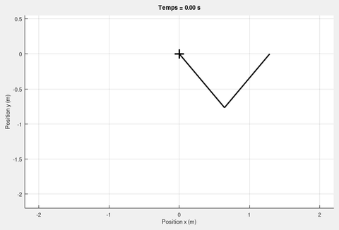
  &nbsp;
  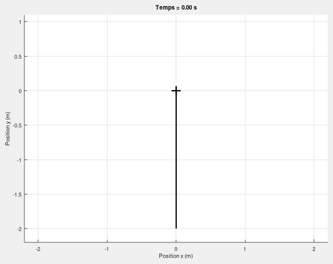
</p>
<p align="center"><em>À gauche : le double pendule à tiges homogènes, lâché sans vitesse. À droite : le même système, actionné par deux moteurs, va de (0°, 0°) à (90°, 45°) en 5 s.</em></p>

---

## Sommaire

- [Démarche](#démarche)
- [Méthode de Lagrange](#méthode-de-lagrange)
- [1. Pendule simple](#1-pendule-simple)
- [2. Pendule pesant (tige homogène)](#2-pendule-pesant-tige-homogène)
- [3. Double pendule à masses ponctuelles](#3-double-pendule-à-masses-ponctuelles)
- [4. Double pendule à tiges homogènes](#4-double-pendule-à-tiges-homogènes)
- [5. Bras 2 axes commandé](#5-bras-2-axes-commandé)
- [Validation numérique](#validation-numérique)
- [Architecture du code](#architecture-du-code)
- [Lancer les simulations](#lancer-les-simulations)
- [Limites et pistes d'amélioration](#limites-et-pistes-damélioration)

---

## Démarche

| Étape | Système | ddl | Ce que l'étape apporte |
|:-:|---|:-:|---|
| 1 | Pendule simple | 1 | Méthode de Lagrange sur le cas de référence |
| 2 | Pendule pesant (tige homogène) | 1 | Masse répartie : énergie cinétique obtenue par intégration le long de la tige |
| 3 | Double pendule à masses ponctuelles | 2 | Écriture matricielle $M(q)\ddot q + C(q,\dot q)\dot q + Q(q) = 0$ |
| 4 | Double pendule à tiges homogènes | 2 | Modèle dynamique complet du bras |
| 5 | Bras 2 axes commandé | 2 actionnés | Génération de trajectoire, couple calculé + PID, réglage et étude des gains |

Les étapes 1 à 4 sont des systèmes libres et conservatifs : on les valide par la **conservation de l'énergie mécanique**. L'étape 5 est un système actionné : on la valide par son **erreur de poursuite**.

---

## Méthode de Lagrange

<p align="center">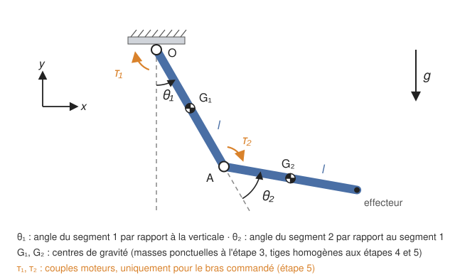</p>

Conventions communes à tous les modèles :

- les angles sont mesurés depuis la verticale descendante, et $\theta_2$ est l'angle **relatif** du second segment par rapport au premier (ce sont directement les coordonnées articulaires du bras) ;
- l'origine est au pivot $O$, avec $x$ horizontal et $y$ vertical vers le haut, d'où $V = m g y$ ;
- toutes les simulations utilisent $m = 1$ kg, $l = 1$ m et $g = 9{,}81$ m/s².

Avec le lagrangien $L = T - V$ et les coordonnées généralisées $q$, les équations du mouvement s'écrivent :

$$\frac{d}{dt}\left(\frac{\partial L}{\partial \dot q}\right) - \frac{\partial L}{\partial q} = \tau$$

avec $\tau = 0$ pour les pendules libres. Lorsque l'énergie cinétique est une forme quadratique des vitesses, $T = \tfrac12\,\dot q^{\top} M(q)\,\dot q$, on aboutit à la forme matricielle utilisée en robotique :

$$M(q)\,\ddot q + C(q,\dot q)\,\dot q + Q(q) = \tau$$

| Terme | Signification | Obtention |
|---|---|---|
| $M(q)$ | Matrice d'inertie, symétrique définie positive | Identification dans $T = \tfrac12\,\dot q^{\top} M\,\dot q$ |
| $C(q,\dot q)\,\dot q$ | Effets centrifuges et de Coriolis | Symboles de Christoffel des dérivées de $M$ |
| $Q(q)$ | Couples de gravité | $Q = \partial V / \partial q$ |

Chaque modèle est mis sous forme d'état $x = (q,\ \dot q)$, avec $\ddot q = M^{-1}\left(\tau - C\,\dot q - Q\right)$, puis intégré par `ode45`.

---

## 1. Pendule simple

Une masse ponctuelle $m$ au bout d'une tige sans masse de longueur $l$ ; une seule coordonnée, $q = \theta$.

$$T = \tfrac12\, m l^2 \dot\theta^2, \qquad V = m g l\,(1 - \cos\theta) \qquad \Longrightarrow \qquad \ddot\theta + \frac{g}{l}\,\sin\theta = 0$$

<details>
<summary><b>Détail du calcul</b></summary>

Position de la masse : $x = l\sin\theta$ et $y = -l\cos\theta$, donc $v^2 = \dot x^2 + \dot y^2 = l^2\dot\theta^2$.

En prenant $V = 0$ au point bas, la masse est à la hauteur $l(1-\cos\theta)$, d'où $L = \tfrac12 m l^2\dot\theta^2 - m g l(1-\cos\theta)$ et :

$$\frac{d}{dt}\left(\frac{\partial L}{\partial \dot\theta}\right) = m l^2 \ddot\theta, \qquad \frac{\partial L}{\partial \theta} = -m g l \sin\theta \qquad \Longrightarrow \qquad m l^2 \ddot\theta + m g l \sin\theta = 0$$

</details>

**Simulation :** $\theta_0 = 45°$, lâché sans vitesse, pendant 15 s.

<p align="center">
  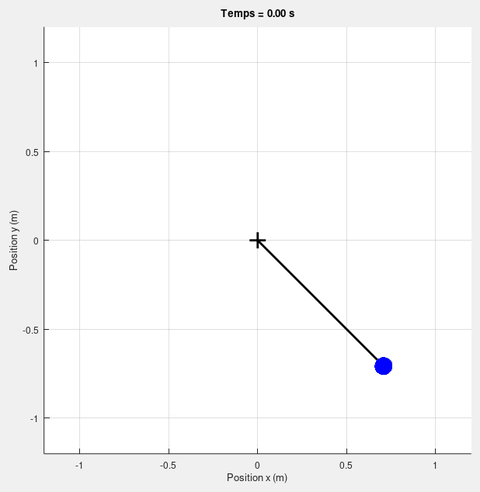
  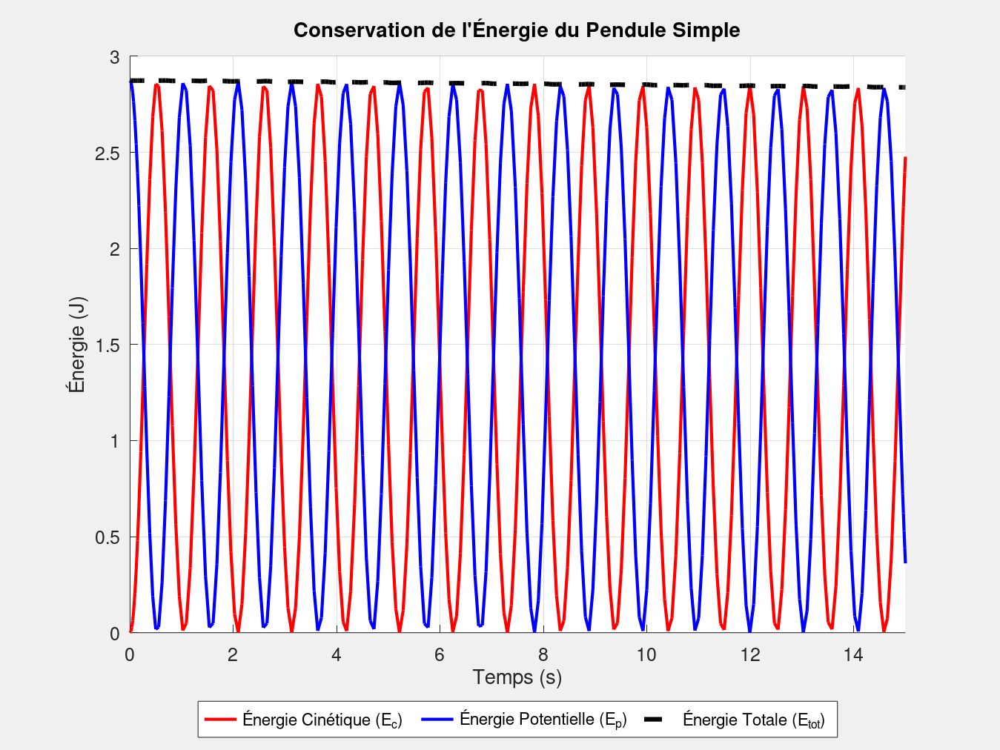
</p>

- Les énergies cinétique et potentielle s'échangent deux fois par période ; l'énergie totale reste à $E_0 = m g l\,(1-\cos 45°) \approx 2{,}87$ J.
- La période simulée, 2,09 s, correspond à la valeur théorique non linéaire à 45° (intégrale elliptique) ; l'approximation des petits angles $2\pi\sqrt{l/g}$ donnerait 2,01 s.
- La légère baisse de l'énergie totale (environ 1 % en 15 s) est d'origine numérique : voir [Validation numérique](#validation-numérique).

---

## 2. Pendule pesant (tige homogène)

La masse $m$ est maintenant répartie uniformément le long de la tige (masse linéique $\mu = m/l$). Les énergies s'obtiennent en intégrant sur chaque élément $dm = \mu\,dr$ situé à la distance $r$ du pivot :

$$T = \int_0^l \tfrac12\,\mu\, r^2\dot\theta^2\,dr = \tfrac16\, m l^2 \dot\theta^2, \qquad V = \int_0^l \mu\, g\, r\,(1-\cos\theta)\,dr = \tfrac12\, m g l\,(1-\cos\theta)$$

$$\Longrightarrow \qquad \ddot\theta + \frac{3g}{2l}\,\sin\theta = 0$$

On retrouve le moment d'inertie d'une tige autour de son extrémité, $J_O = m l^2/3$. La tige se comporte comme un pendule simple de longueur équivalente $2l/3$ : elle oscille plus vite, avec une période de 1,70 s à 45° contre 2,09 s pour le pendule simple.

<p align="center">
  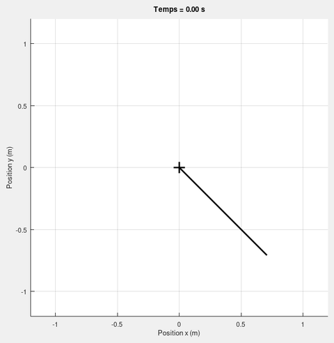
  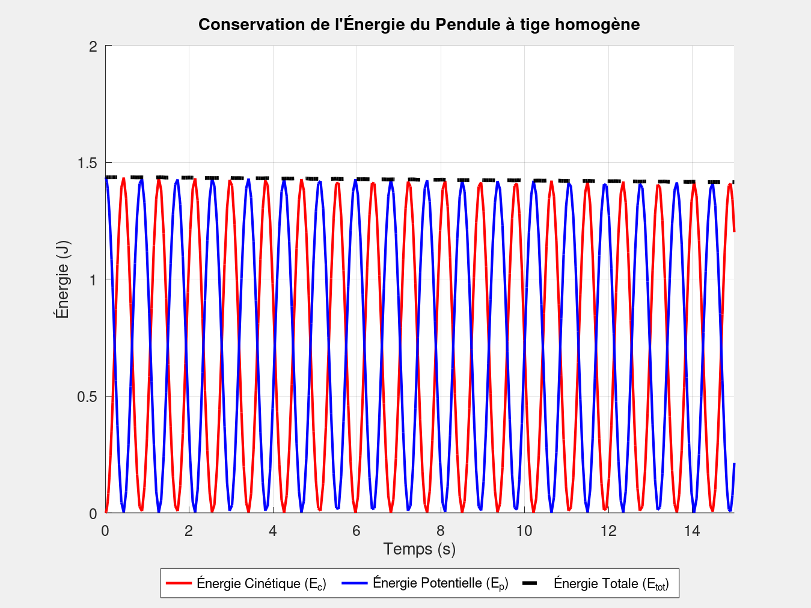
</p>

L'énergie totale vaut ici $E_0 = \tfrac12 m g l\,(1-\cos 45°) \approx 1{,}44$ J : deux fois moins que pour le pendule simple, puisque le centre de gravité est à mi-longueur.

---

## 3. Double pendule à masses ponctuelles

Deux tiges sans masse de longueur $l$, avec une masse $m$ au milieu de chacune ($G_1$ et $G_2$ sur le schéma) ; $q = (\theta_1, \theta_2)$.

$$\overrightarrow{OG_1} = \frac{l}{2}\begin{bmatrix}\sin\theta_1\\ -\cos\theta_1\end{bmatrix}, \qquad \overrightarrow{OG_2} = l\begin{bmatrix}\sin\theta_1\\ -\cos\theta_1\end{bmatrix} + \frac{l}{2}\begin{bmatrix}\sin(\theta_1+\theta_2)\\ -\cos(\theta_1+\theta_2)\end{bmatrix}$$

$$M(q) = m l^2\begin{bmatrix} \tfrac32 + \cos\theta_2 & \tfrac14 + \tfrac12\cos\theta_2 \\ \tfrac14 + \tfrac12\cos\theta_2 & \tfrac14 \end{bmatrix}$$

$$C(q,\dot q) = -\tfrac12\, m l^2 \sin\theta_2 \begin{bmatrix} \dot\theta_2 & \dot\theta_1 + \dot\theta_2 \\ -\dot\theta_1 & 0 \end{bmatrix}, \qquad Q(q) = \tfrac12\, m g l\begin{bmatrix} 3\sin\theta_1 + \sin(\theta_1+\theta_2) \\ \sin(\theta_1+\theta_2) \end{bmatrix}$$

<details>
<summary><b>Détail du calcul</b></summary>

Vitesses des deux masses :

$$v_1^2 = \frac{l^2}{4}\,\dot\theta_1^2, \qquad v_2^2 = l^2\dot\theta_1^2 + \frac{l^2}{4}\,(\dot\theta_1+\dot\theta_2)^2 + l^2\cos\theta_2\;\dot\theta_1(\dot\theta_1+\dot\theta_2)$$

En développant $T = \tfrac12 m v_1^2 + \tfrac12 m v_2^2$ :

$$T = m l^2\left[\left(\tfrac34 + \tfrac12\cos\theta_2\right)\dot\theta_1^2 + \left(\tfrac14 + \tfrac12\cos\theta_2\right)\dot\theta_1\dot\theta_2 + \tfrac18\,\dot\theta_2^2\right]$$

On identifie ensuite avec $T = \tfrac12\,\dot q^{\top}M\dot q = \tfrac12 M_{11}\dot\theta_1^2 + M_{12}\,\dot\theta_1\dot\theta_2 + \tfrac12 M_{22}\dot\theta_2^2$. Attention au facteur $\tfrac12$ : $M_{11}$ et $M_{22}$ valent **deux fois** les coefficients de $\dot\theta_1^2$ et $\dot\theta_2^2$.

Énergie potentielle (référence au niveau du pivot) :

$$V = m g\,(y_{G_1} + y_{G_2}) = -m g l\left(\tfrac32\cos\theta_1 + \tfrac12\cos(\theta_1+\theta_2)\right), \qquad Q = \frac{\partial V}{\partial q}$$

Coriolis : seule $\theta_2$ apparaît dans $M$. En posant $h = \partial M_{12}/\partial\theta_2 = -\tfrac12 m l^2\sin\theta_2$, avec $\partial M_{11}/\partial\theta_2 = 2h$, les symboles de Christoffel donnent :

$$C(q,\dot q) = h\begin{bmatrix} \dot\theta_2 & \dot\theta_1+\dot\theta_2 \\ -\dot\theta_1 & 0 \end{bmatrix}$$

</details>

**Vérification de cohérence :** bras tendu ($\theta_2 = 0$), $M_{11} = \tfrac52\, m l^2 = m\left(\tfrac{l}{2}\right)^2 + m\left(\tfrac{3l}{2}\right)^2$, soit bien le moment d'inertie des deux masses autour de $O$.

**Simulation :** $\theta_1(0) = 40°$ et $\theta_2(0) = 100°$, lâché sans vitesse, pendant 15 s.

<p align="center">
  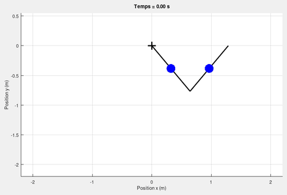
  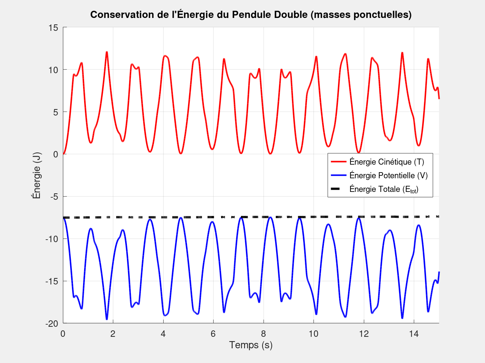
</p>

- Le mouvement est irrégulier et non périodique. Contrairement aux pendules à un degré de liberté, le double pendule est un système couplé fortement non linéaire, connu pour son comportement chaotique à grande amplitude.
- Les deux segments échangent en permanence plus de 10 J entre énergie cinétique et énergie potentielle, alors que l'énergie totale reste à $E_0 \approx -7{,}52$ J.

---

## 4. Double pendule à tiges homogènes

Chaque segment est maintenant une tige homogène de masse $m$ et de longueur $l$ : c'est le modèle du bras de l'étape 5. Comme pour le pendule pesant, l'énergie cinétique de la seconde tige s'obtient par intégration. Un point situé à la distance $r$ de l'articulation $A$ a pour vitesse :

$$\lVert \dot{\mathbf p}(r)\rVert^2 = l^2\dot\theta_1^2 + r^2(\dot\theta_1+\dot\theta_2)^2 + 2\,l\,r\cos\theta_2\;\dot\theta_1(\dot\theta_1+\dot\theta_2)$$

$$T = \tfrac16\, m l^2\dot\theta_1^2 + \int_0^l \tfrac12\,\mu\,\lVert \dot{\mathbf p}(r)\rVert^2\, dr = m l^2\left[\left(\tfrac56 + \tfrac12\cos\theta_2\right)\dot\theta_1^2 + \left(\tfrac13 + \tfrac12\cos\theta_2\right)\dot\theta_1\dot\theta_2 + \tfrac16\,\dot\theta_2^2\right]$$

d'où, avec la même identification qu'à l'étape 3 :

$$M(q) = m l^2\begin{bmatrix} \tfrac53 + \cos\theta_2 & \tfrac13 + \tfrac12\cos\theta_2 \\ \tfrac13 + \tfrac12\cos\theta_2 & \tfrac13 \end{bmatrix}$$

Les centres de gravité des tiges sont exactement là où se trouvaient les masses ponctuelles de l'étape 3. L'énergie potentielle, donc $Q(q)$, est **identique**, et $C(q,\dot q)$ aussi, car les dérivées de $M$ sont les mêmes. Seule l'inertie change : chaque tige ajoute sa rotation propre autour de son centre de gravité ($m l^2/12$), soit :

$$M_{\text{tiges}}(q) = M_{\text{masses}}(q) + \frac{m l^2}{12}\begin{bmatrix} 2 & 1 \\ 1 & 1 \end{bmatrix}$$

**Vérification de cohérence :** bras tendu, $M_{11} = \tfrac83\, m l^2 = (2m)(2l)^2/3$, soit le moment d'inertie d'une tige unique de masse $2m$ et de longueur $2l$ autour de son extrémité.

**Simulation :** mêmes conditions initiales qu'à l'étape 3 ($40°$ et $100°$) pour comparer les deux modèles.

<p align="center">
  
  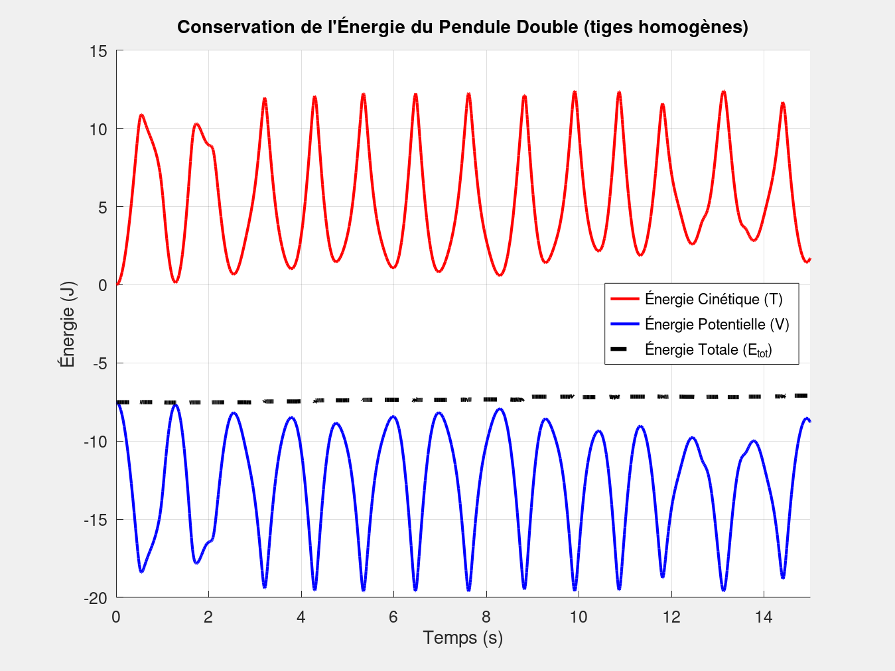
</p>

L'énergie totale est la même qu'à l'étape 3 ($E_0 \approx -7{,}52$ J, puisque l'énergie potentielle initiale est identique), mais la dynamique diffère : à configuration égale, l'inertie est plus grande.

---

## 5. Bras 2 axes commandé

### Modèle

Le bras reprend le double pendule à tiges homogènes, désormais actionné par un moteur à chaque articulation :

$$M(q)\,\ddot q + C(q,\dot q)\,\dot q + Q(q) = \tau$$

Les articulations sont actionnées par des moteurs à courant continu munis d'une boucle de courant ($\Gamma_m = J_m\ddot q_m + \tau/N$, avec $N$ le rapport de réduction). Dans la simulation, la boucle de courant et la transmission sont supposées idéales : la commande impose directement les couples articulaires $\tau$.

### Génération de trajectoire

Le bras part de $q_0 = (0°, 0°)$, bras pendant, et doit atteindre $q_f = (90°, 45°)$ en $t_f = 5$ s. Chaque articulation suit un polynôme de degré 5, choisi pour imposer des vitesses **et** des accélérations nulles au départ comme à l'arrivée :

$$q_d(t) = q_0 + (q_f - q_0)\left[10\left(\frac{t}{t_f}\right)^3 - 15\left(\frac{t}{t_f}\right)^4 + 6\left(\frac{t}{t_f}\right)^5\right], \qquad 0 \le t \le t_f$$

L'accélération est continue, donc les couples demandés n'ont pas de saut. Les vitesses maximales, atteintes à $t = 2{,}5$ s, valent 0,59 rad/s pour $\theta_1$ et 0,29 rad/s pour $\theta_2$ ; les accélérations maximales valent 0,36 et 0,18 rad/s².

### Loi de commande : couple calculé + PID

$$\tau = M(q)\,v + C(q,\dot q)\,\dot q + Q(q), \qquad v = \ddot q_d + K_v\,\dot e + K_p\,e + K_i\int_0^t e\,d\sigma, \qquad e = q_d - q$$

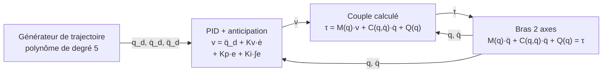

Le couple calculé utilise le modèle dynamique pour compenser exactement l'inertie, les effets de Coriolis et la gravité. En reportant $\tau$ dans le modèle, il reste $\ddot q = v$ : le bras se comporte comme deux doubles intégrateurs **découplés** (linéarisation exacte par retour d'état). L'erreur de chaque articulation obéit alors à :

$$\dddot e + K_v\,\ddot e + K_p\,\dot e + K_i\,e = 0$$

**Réglage par placement de pôles.** Pour obtenir la réponse la plus rapide sans dépassement, on place un pôle triple en $-\omega_n$ :

$$(s+\omega_n)^3 = s^3 + 3\omega_n s^2 + 3\omega_n^2 s + \omega_n^3 \qquad \Longrightarrow \qquad K_p = 3\omega_n^2, \quad K_v = 3\omega_n, \quad K_i = \omega_n^3$$

Avec $\omega_n = 10$ rad/s : $K_p = 300$, $K_v = 30$ et $K_i = 1000$, identiques pour les deux articulations. L'intégrale de l'erreur est ajoutée au vecteur d'état intégré par `ode45` : $y = \left(q,\ \dot q,\ \int e\right)$, soit 6 états.

### Résultats

<p align="center">
  
  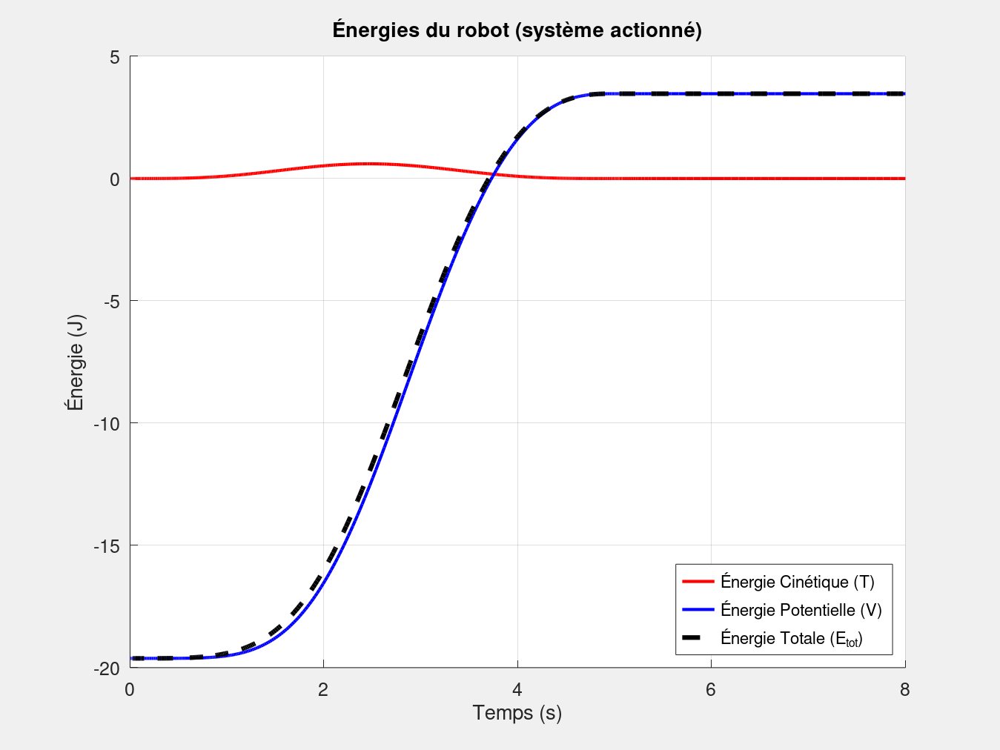
</p>
<p align="center">
  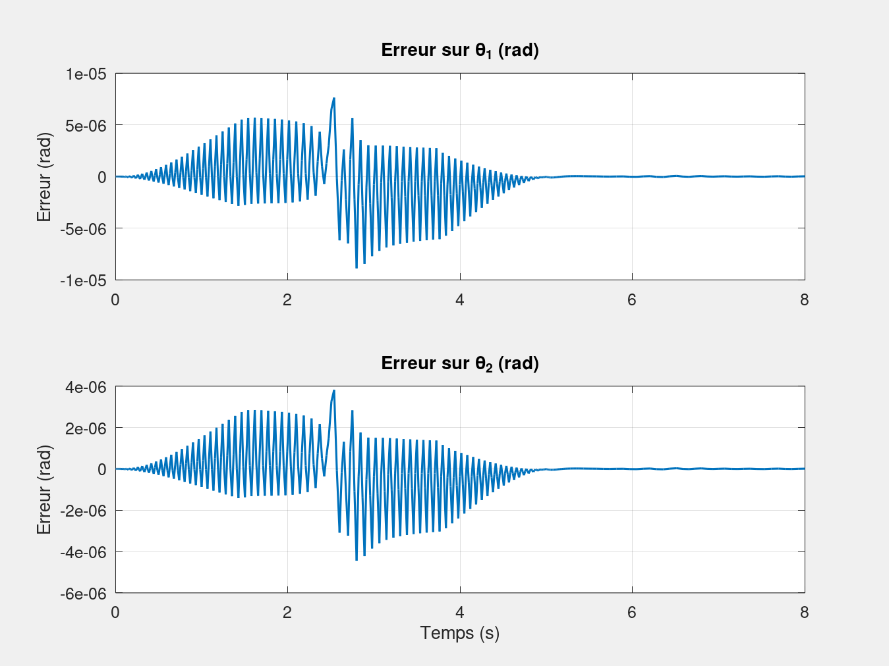
</p>

- Le bras atteint $(90°, 45°)$ en 5 s, sans dépassement.
- **L'erreur de poursuite reste inférieure à $10^{-5}$ rad**, et ce résidu ne vient pas de la commande. Le modèle utilisé par la commande est exact et le bras part sur la trajectoire ($e = \dot e = 0$ et $\int e = 0$) : l'erreur est donc théoriquement nulle. Ce qu'on observe est l'erreur d'intégration d'`ode45`. Avec les tolérances par défaut, $\max\lvert e_1\rvert \approx 9\cdot10^{-6}$ rad ; avec `RelTol = 1e-10`, elle tombe à environ $2\cdot10^{-12}$ rad.
- **L'énergie n'est plus conservée.** Elle augmente de $\Delta V \approx 23{,}1$ J (de $-19{,}62$ J à $+3{,}47$ J), ce qui correspond au travail fourni par les moteurs contre la gravité. L'énergie cinétique reste inférieure à 0,6 J : le mouvement est lent et la gravité domine. À l'arrivée, les moteurs doivent maintenir des couples statiques $Q(q_f) \approx (18{,}2\ ;\ 3{,}5)$ N·m.

### Étude de sensibilité aux gains

Chaque gain est modifié seul autour du réglage nominal. La dynamique de l'erreur étant linéaire, chaque comportement se prévoit à partir des racines de $s^3 + K_v s^2 + K_p s + K_i$ et du critère de Routh, qui exige $K_v K_p > K_i$ pour la stabilité :

| Essai | $K_p$ | $K_v$ | $K_i$ | Pôles en boucle fermée | Comportement |
|---|:-:|:-:|:-:|---|---|
| Nominal | 300 | 30 | 1000 | $-10$ (triple) | Amortissement critique : rapide, sans oscillation |
| $K_p$ faible | 30 | 30 | 1000 | $+0{,}05 \pm 5{,}76j$ et $-30{,}1$ | **Instable**, car $K_v K_p = 900 < K_i$ : oscillation à 0,92 Hz qui croît lentement |
| $K_p$ fort | 3000 | 30 | 1000 | $-14{,}8 \pm 52{,}6j$ et $-0{,}33$ | Mode rapide peu amorti (8,4 Hz, $\zeta = 0{,}27$) et pôle lent |
| $K_v$ faible | 300 | 5 | 1000 | $-0{,}80 \pm 17{,}1j$ et $-3{,}39$ | Très peu amorti ($\zeta = 0{,}05$) : oscillations à 2,7 Hz longues à s'éteindre |
| $K_v$ fort | 300 | 100 | 1000 | $-1{,}49 \pm 2{,}84j$ et $-97{,}0$ | Stable mais raide : le pôle à $-97$ rad/s impose de très petits pas à `ode45` |
| $K_i$ nul | 300 | 30 | 0 | $-15 \pm 8{,}66j$ | Correcteur PD bien amorti ($\zeta = 0{,}87$), mais sans correction d'une erreur statique |
| $K_i$ fort | 300 | 30 | 5000 | $-2{,}06 \pm 13{,}7j$ et $-25{,}9$ | Peu amorti ($\zeta = 0{,}15$) : oscillations à 2,2 Hz après le mouvement |

<p align="center">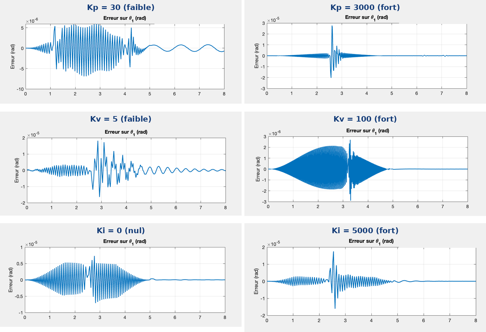</p>
<p align="center"><em>Erreur de poursuite sur θ₁ (rad) en fonction du temps (s) pour chaque essai. Attention, l'échelle verticale change d'un essai à l'autre.</em></p>

**Lecture.** En simulation, la seule « perturbation » qui excite la dynamique de l'erreur est l'erreur d'intégration numérique : les amplitudes restent donc de l'ordre du microradian. La forme des réponses correspond en revanche aux pôles calculés :

- oscillation de période ≈ 1,1 s qui ne s'amortit pas pour $K_p = 30$ ;
- oscillation à 2,7 Hz lentement amortie pour $K_v = 5$ ;
- bruit haute fréquence pendant le mouvement pour $K_v = 100$, dû aux pas de calcul très courts et non à une instabilité ;
- oscillation à 2,2 Hz après le mouvement pour $K_i = 5000$.

Le réglage nominal à pôle triple reste le meilleur compromis entre rapidité et amortissement.

---

## Validation numérique

Les modèles des étapes 1 à 4 sont conservatifs : toute variation de leur énergie totale est une erreur numérique. Avec les tolérances par défaut d'`ode45` (`RelTol = 1e-3`, `AbsTol = 1e-6`), on observe une petite dérive. Elle disparaît quand on resserre les tolérances, ce qui confirme que les équations sont justes :

| Cas | $E_0$ | Dérive sur 15 s, tolérances par défaut | Dérive avec `RelTol = 1e-10`, `AbsTol = 1e-12` |
|---|:-:|:-:|:-:|
| Pendule simple | 2,873 J | −0,035 J (−1,2 %) | ≈ 2·10⁻⁹ J |
| Pendule pesant | 1,437 J | −0,021 J (−1,5 %) | ≈ 1·10⁻⁹ J |
| Double pendule, masses ponctuelles | −7,515 J | +0,12 J | < 2·10⁻⁸ J |
| Double pendule, tiges homogènes | −7,515 J | +0,42 J | < 2·10⁻⁸ J |
| Bras commandé (erreur de poursuite max.) | — | 9·10⁻⁶ rad | 2·10⁻¹² rad |

Les périodes simulées des pendules à un degré de liberté (2,086 s et 1,703 s) correspondent aux valeurs théoriques non linéaires à 45°. Pour reproduire la dernière colonne, il suffit de passer `odeset('RelTol', 1e-10, 'AbsTol', 1e-12)` en dernier argument d'`ode45`.

---

## Architecture du code

```
Robot Arm Dynamics/
├── src/
│   ├── 1_pendule_simple/
│   │   ├── Pendule_simple.m              # dynamique : dq/dt = f(t, q)
│   │   └── sim_pendule_simple.m          # simulation, animation, bilan d'énergie
│   ├── 2_pendule_tige/
│   │   ├── Pendule_lineique.m
│   │   └── sim_pendule_lineique.m
│   ├── 3_double_pendule_masses/
│   │   ├── Pendule_double.m              # M(q), C(q,q̇), Q(q) puis q̈ = M⁻¹(−C·q̇ − Q)
│   │   └── sim_pendule_double.m          # + export de l'animation en MP4
│   ├── 4_double_pendule_tiges/
│   │   ├── Pendule_double_lineique.m
│   │   └── sim_pendule_double_lineique.m
│   └── 5_bras_commande/
│       ├── gen_traj.m                    # trajectoire polynomiale de degré 5 : q_d, q̇_d, q̈_d
│       ├── Dynamique_Controle.m          # couple calculé + PID, puis dynamique directe du bras
│       └── sim_bras_commande.m           # simulation, animation, énergies, erreur de poursuite
└── media/                                # animations et figures du README
```

- Chaque fonction de dynamique a la signature `dx = f(t, x, ...)`, directement utilisable par `ode45`. Les scripts `sim_*.m` fixent les paramètres et les conditions initiales, lancent l'intégration, puis tracent l'animation et les bilans.
- `Dynamique_Controle.m` regroupe la commande et le « robot réel » : il calcule $\tau$ à partir du modèle, puis l'injecte dans la dynamique directe $\ddot q = M^{-1}(\tau - C\dot q - Q)$. Le modèle de commande et le modèle simulé sont identiques, ce qui correspond au cas idéal d'un modèle parfaitement connu.

---

## Lancer les simulations

**Prérequis :** MATLAB, sans toolbox particulière.

```matlab
cd src/4_double_pendule_tiges
sim_pendule_double_lineique
```

Chaque script affiche l'animation, puis les courbes d'énergie et, pour le bras, l'erreur de poursuite. Les scripts des étapes 3 à 5 enregistrent aussi l'animation en MP4 (`VideoWriter`).

Les scripts tournent également sous **GNU Octave** (testés avec la version 8.4), sauf l'export MP4 : `VideoWriter` n'existe pas dans Octave, il suffit de commenter les lignes correspondantes. Les animations et les courbes d'énergie de ce README sont produites par les scripts du dépôt ; l'étude des gains a été réalisée en modifiant les gains dans `sim_bras_commande.m`.

---

## Limites et pistes d'amélioration

- **Intégration numérique :** les tolérances par défaut d'`ode45` suffisent pour visualiser, pas pour une conservation fine de l'énergie. Pour de longues simulations de systèmes conservatifs, un intégrateur symplectique serait plus adapté.
- **Robustesse de la commande :** le modèle de commande est ici parfait, d'où une erreur nulle. L'étape suivante consiste à introduire des erreurs de modèle (masses ou longueurs mal connues, charge en bout de bras), des frottements et du bruit de mesure. C'est là que l'action intégrale et le choix de $\omega_n$ prennent tout leur sens.
- **Actionneurs :** ajouter la dynamique des moteurs (inertie du rotor $J_m$, réducteur $N$, boucle de courant), la saturation des couples et une commande échantillonnée. $\omega_n$ doit aussi rester inférieure à la moitié de la première pulsation de résonance de la structure.
- **Espace opérationnel :** piloter directement la position de l'effecteur à l'aide des modèles géométrique et cinématique inverses (jacobienne).

---

## Compétences mobilisées

`Mécanique lagrangienne` · `Modèle dynamique M(q), C(q,q̇), Q(q)` · `Commande par couple calculé` · `PID et placement de pôles` · `Critère de Routh` · `Génération de trajectoire` · `Intégration numérique (ode45)` · `MATLAB / GNU Octave`

---

*Projet réalisé dans le cadre d'un cours de dynamique et de commande des robots en école d'ingénieur.*<br/>
*Auteur : Thomas Jourdan*
